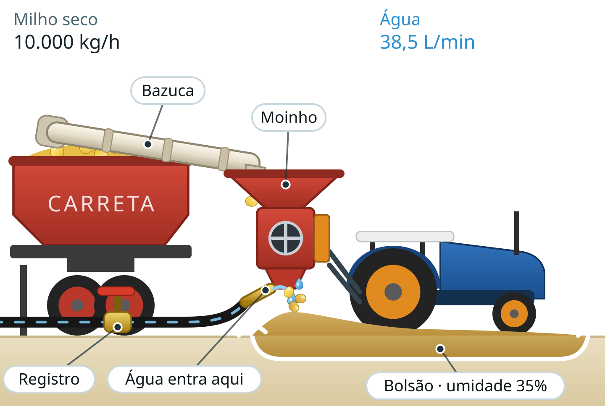

<div align="center">


### Quanta água o milho precisa para ficar com a umidade certa?

Calculadora para **silagem de grão úmido**: informe o milho e a umidade que você quer, e o app diz quantos litros de água usar e quanto abrir o registro da mangueira.

<br />


</div>

---

## Como funciona o processo

Na prática do campo, o grão úmido é feito assim: a carreta joga o milho seco, pela **bazuca**, no **moinho** preso ao trator. Uma **mangueira** injeta a água na saída do moinho, junto com o milho moído, e o milho molhado cai no **bolsão** (uma vala forrada de plástico), onde é espalhado, compactado, coberto e fermenta.

<div align="center">
  
</div>

O segredo é a **água certa**: pouca deixa o grão seco demais, muita encharca. O Mcalc calcula a quantidade para chegar à umidade desejada, dentro da faixa segura de **30% a 40%**.

## O que o app faz

**Aba Lote**
- Calcula os **litros de água** para um lote, dadas a massa de milho, a umidade atual e a umidade almejada.
- Mostra os litros por kg de milho, a umidade resultante (conferência) e um selo e uma barra da faixa segura (30–40%).
- Aceita a umidade em **matéria seca (MS)** ou em umidade, e converte entre as duas.

**Aba Vazão**
- Converte a vazão de milho da bazuca (kg/h ou t/h) na **vazão de água em L/min**.
- Compara as bitolas de cano pela velocidade da água (ideal de 0,4 a 2,5 m/s) e recomenda a menor que comporta a vazão.
- Confere a **vazão real medida** (enchendo um balde, por exemplo) e mostra a umidade que ela produz.
- Com a massa do lote, calcula o **tempo de operação** e o **volume total de água**.
- Mostra o diagrama do processo com os números do usuário.

**No geral**
- A massa e as umidades são **compartilhadas entre as abas**: o que você digita em uma aparece na outra.
- **Compartilhar** o resultado como texto pronto para WhatsApp, e **limpar** os valores para começar outro lote.
- Guarda no aparelho a vazão de milho, a unidade e o cano escolhido.
- Funciona offline.

## As contas

Convenção: 1 L de água = 1 kg. Umidades em %.

```text
Água do lote (L)      = massa × (100 − U_atual) / (100 − U_alvo) − massa
Água por kg de milho  = (100 − U_atual) / (100 − U_alvo) − 1
Vazão de água (L/h)   = vazão de milho (kg/h) × água por kg
```

As fórmulas ficam em [`src/calc.ts`](src/calc.ts) e são cobertas por testes automatizados.

## Rodando o projeto

Requisitos: Node 22.13+ (ou 24.3+) e npm.

```bash
npm install
npx expo start
```

Abra no celular com o Expo Go (versão compatível com o SDK 58) ou num *development build*.

| Comando | O que faz |
|---|---|
| `npm test` | roda os testes das contas e do resumo |
| `npm run typecheck` | confere os tipos (TypeScript estrito) |
| `npm run lint` | confere o código |
| `npm run icons` | gera os ícones e a splash em `assets/` |
| `npm run logos` | gera as logos em `assets/logo/` |
| `npm run apk` | gera o APK pelo EAS (veja abaixo) |

## Gerando o APK

O build é feito na nuvem pelo [EAS Build](https://docs.expo.dev/build/introduction/).

```bash
npx eas-cli@latest login
npm run apk
```

Na primeira vez, o EAS pergunta se deve gerar uma chave de assinatura para o Android: aceite. Ao terminar, ele mostra o link para baixar o `.apk`, que é só instalar no aparelho.

## Estrutura

```text
App.tsx                abas, cabeçalho, teclado e janelas
src/
  calc.ts              fórmulas (água, vazão, cano, umidade)
  resumo.ts            texto do resultado para compartilhar
  TelaLote.tsx         aba Lote
  TelaVazao.tsx        aba Vazão
  Processo.tsx         diagrama do processo
  Dialogo.tsx          janela de confirmação
  Logo*.tsx, coruja.json, marca.json, lockup.json   identidade visual
  theme.ts, ui.tsx     cores, fontes e componentes
tests/                 testes (node:test + tsx)
scripts/               geradores de ícones e logos, e prévias
docs/                  imagens do README
```

## Identidade visual

A marca é a coruja com o nome **Mcalc**, nas cores azul-céu `#66BCE2`, azul-aço `#447B94` e verde-azulado escuro `#1F3239`, com a fonte [Outfit](https://fonts.google.com/specimen/Outfit). O desenho da coruja e o layout das logos ficam em arquivos JSON em `src/`, e os ícones e logos em `assets/` são gerados a partir deles.
